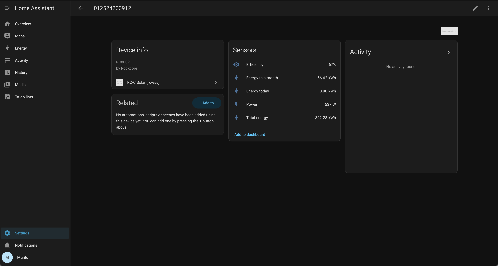

# RC-C Solar for Home Assistant (`rcess_solar`)

[](https://github.com/YOUR_GITHUB_USERNAME/RC-C/actions/workflows/validate.yml)
[](https://hacs.xyz)
[](LICENSE)

An **unofficial** [Home Assistant](https://www.home-assistant.io/) integration
for **Rockcore RC-C solar micro-inverters** — the ones monitored through the
*RC-C* mobile app (Shanghai Rockcore Electronics Technology).

It brings live production data from the `app.rc-ess.com` cloud into Home
Assistant, so your balcony / rooftop micro-inverter shows up as a proper device
with sensors and works with the **Energy dashboard**.

> ⚠️ Not affiliated with or endorsed by Rockcore. The upstream API is
> undocumented and reverse-engineered — it may change or break at any time.
> Use only with your own account and hardware.

---

## Screenshot



*The micro-inverter exposed as a Home Assistant device, with live Power,
daily / monthly / lifetime energy, and efficiency sensors.*

---

## Features

- 🔌 **Live power** (W)
- ☀️ **Energy today**, **this month**, and **lifetime total** (kWh)
- 📈 **Inverter efficiency** (%)
- 🏠 One Home Assistant **device per inverter**, auto-discovered from your account
- ⚡ **Energy dashboard** compatible (`Total energy` → *Solar production*)
- ☁️ Cloud polling with a configurable update interval (default 60s)

### Sensors

| Sensor            | Unit | Device class | State class      |
| ----------------- | ---- | ------------ | ---------------- |
| Power             | W    | power        | measurement      |
| Energy today      | kWh  | energy       | total_increasing |
| Energy this month | kWh  | energy       | total_increasing |
| Total energy      | kWh  | energy       | total_increasing |
| Efficiency        | %    | —            | measurement      |

---

## Installation

### HACS (recommended)

1. In HACS → **⋮** → **Custom repositories**.
2. Add `https://github.com/mnrmurilo/RC-C` as category **Integration**.
3. Search for **RC-C Solar** and download it.
4. **Restart** Home Assistant.

### Manual

Copy `custom_components/rcess_solar` into your Home Assistant
`config/custom_components/` directory and restart.

---

## Configuration

1. **Settings → Devices & services → Add integration**.
2. Search for **RC-C Solar (rc-ess)**.
3. Enter the **email and password** you use in the RC-C app.

That's it — your inverter(s) are discovered automatically.

The polling interval can be changed later via the integration's
**Configure** (Options) button (15–3600 seconds).

### Energy dashboard

**Settings → Dashboards → Energy → Add solar production** and select the
**Total energy** sensor.

---

## How this was built (reverse engineering)

There is **no local API** on the inverter and no official integration, so the
data had to be pulled from the same cloud the RC-C app uses. The whole thing
was figured out in my **homelab** using a man-in-the-middle proxy.

> **Homelab note:** everything below ran on my own LAN against my own account
> and my own inverter. Nothing here touches anyone else's data.

### 1. Confirm there's no local access

A full TCP port scan of the inverter (`1–65535`) returned **nothing** open, and
it answered no Tuya / Solarman / Modbus / SSDP / mDNS / SNMP discovery probes.
It only talks outbound to the vendor cloud — so a cloud integration it is.

### 2. Identify the real backend

An existing community integration
([`ErwinSt/home-assistant-solarcore-energy`](https://github.com/ErwinSt/home-assistant-solarcore-energy))
targets a **legacy** server (`gf.rockcore-energy.com:9721/rcmi-manager`) and
returned *"User not registered"* for my account — newer RC-C accounts live on a
**different** platform.

Decompiling the RC-C app (an Expo / React Native app, same build on iOS and
Android) showed it's a thin shell around a web app served from
**`app.rc-ess.com`** via a `jowoiot` IoT backend.

### 3. Capture the live traffic (the homelab proxy)

I ran **[mitmproxy](https://mitmproxy.org/)** on a **Proxmox LXC container** in
the homelab instead:

```
iPhone (RC-C app)  ──HTTP proxy──▶  mitmproxy on LXC (192.168.68.x:8080)  ──▶  app.rc-ess.com
```

- iPhone **Wi-Fi → Configure Proxy → Manual** pointed at the container.
- Installed + trusted the mitmproxy CA on the phone
  (**Settings → General → About → Certificate Trust Settings**).
- Logged into RC-C once and opened the inverter's live view to record the
  full login + telemetry flow.

Capturing on a dedicated homelab box (rather than the laptop) sidestepped the
corporate firewall entirely and kept the capture off the work machine.

### 4. Rebuild the API contract

From the capture, the request/response contract was reconstructed and then
**verified live** against the server before writing a single line of the
integration.

---

## API reference

Base URL: `https://app.rc-ess.com/jowoiot-proxy/api`

All requests send these tenant headers (observed from the app):

```
Content-Type: application/json;charset=utf-8
scope: yx_test
OwnerId: 1
oem: rc
```

### Login

```http
POST /project/rc/auth/login
{ "channelType": 2, "content": "<email>", "password": "<password>", "type": "2" }
```

Response → `data.response.accessToken` (a bearer token). All subsequent calls
send `Authorization: Bearer <accessToken>`; on `401` the client simply logs in
again.

### List stations

```http
POST /project/rc/station/overview/searchStation
{ "page": 1, "row": 100 }
```

→ `data.content[] { id, name, ... }`

### List devices for a station

```http
GET /project/rc/station/item/getList?stationId={stationId}
```

→ `[ { id, sn, model, stationId, ... } ]`

### Live device data

```http
GET /project/rc/device/data/{deviceId}
```

```jsonc
{
  "power": 537,          // current AC power, W
  "efficiency": 67,      // %
  "dayEnergy": 900,      // Wh  -> 0.90 kWh
  "monthEnergy": "56620",// Wh  -> 56.62 kWh
  "yearEnergy": "392280",
  "accEnergy": "392280", // lifetime Wh -> 392.28 kWh
  "model": "RC8009",
  "isOnline": true,
  "state": true
}
```

Energy fields are in **Wh** and divided by 1000 for the kWh sensors.

---

## Repository structure

```
RC-C/
├── custom_components/
│   └── rcess_solar/
│       ├── __init__.py       # setup + DataUpdateCoordinator
│       ├── api.py            # async client for app.rc-ess.com
│       ├── config_flow.py    # UI login + options
│       ├── const.py          # endpoints + tenant headers
│       ├── sensor.py         # sensor entities
│       ├── manifest.json
│       └── translations/en.json
├── docs/
│   └── home-assistant-device.png
├── .github/workflows/validate.yml  # hassfest + HACS CI
├── hacs.json
├── README.md
├── SECURITY.md
├── LICENSE
└── .gitignore
```

---

## Disclaimer

This is a personal, best-effort project provided **as-is** under the MIT
license. It depends on an undocumented third-party cloud API that can change
without notice. Not affiliated with Rockcore. See [SECURITY.md](SECURITY.md)
for how credentials are handled and how to report issues.
